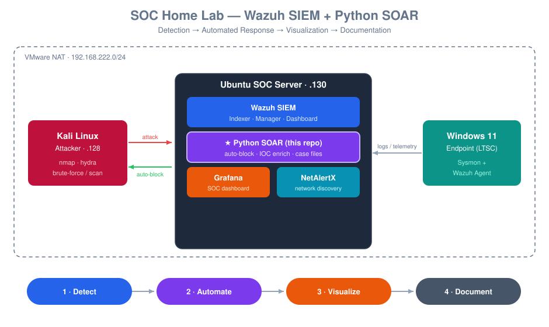
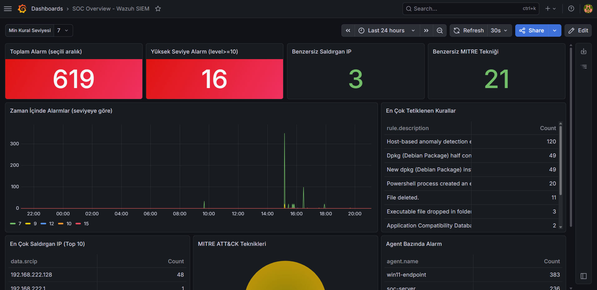
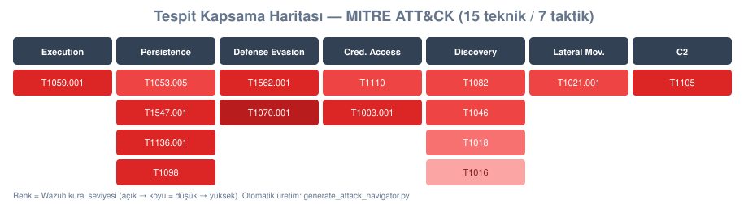

# 🛡️ SOC Home Lab — SIEM + SOAR Tespit & Müdahale Projesi


Uçtan uca bir **Blue Team / SOC Analyst** ev laboratuvarı: Wazuh SIEM ile tespit,
Python tabanlı **SOAR** ile otomatik müdahale, MITRE ATT&CK eşleşmeli özel kurallar
ve örnek olay müdahale (Incident Response) akışı.

## ✨ Öne Çıkanlar

- 🔴 **Gerçek saldırı → otomatik engelleme:** Kali brute-force'u saniyeler içinde `iptables` + Wazuh Active Response ile bloke
- 🧠 **5 kaynaklı IOC zenginleştirme** (AbuseIPDB · VirusTotal · OTX · Shodan · GreyNoise) + otomatik **tehdit kararı** (clean / suspicious / malicious)
- 🎯 **12 özel MITRE ATT&CK kuralı** + **Sigma** detection-as-code
- 📊 **2 canlı Grafana dashboard** + **ATT&CK Navigator** kapsama haritası (15 teknik)
- 📄 Olaylardan **otomatik Incident Response raporu** üretimi
- 🔔 **Telegram & Discord** bildirimleri (renk kodlu, verdict'li)
- 🐳 **Docker** + ⚙️ **systemd** dağıtımı
- ✅ **GitHub Actions CI:** lint + 15 birim test + XML/YAML/JSON doğrulama

## 🧱 Mimari



<details>
<summary>ASCII diyagram (metin)</summary>

```
                 192.168.222.0/24 (VMware NAT)
  ┌─────────────────┐      ┌──────────────────────────────┐
  │  Kali Linux     │      │  Ubuntu SOC Server (.130)     │
  │  (Attacker)     │─────▶│  • Wazuh Indexer/Mgr/Dash     │
  │  nmap, hydra    │ atak │  • Python SOAR (bu repo)      │
  └─────────────────┘      │  • Grafana, NetAlertX (Docker)│
                           └───────────────┬───────────────┘
  ┌─────────────────┐                      │ agent
  │ Win11 Endpoint  │──────────────────────┘
  │ Sysmon + Wazuh  │  log/telemetri
  └─────────────────┘
```

</details>

## 📸 Görseller & Ekran Görüntüleri

**SOC Overview Dashboard** — canlı Wazuh indexer verisiyle (619 alarm, 16 kritik, 21 MITRE tekniği):



**Tespit Kapsama Haritası** — kurallardan otomatik üretilir:



> İstersen SOAR'ın canlı engelleme log'unu da ekleyebilirsin: `soar.log` görüntüsünü
> `docs/screenshots/soar-live-block.png` adıyla kaydet (bkz. [docs/screenshots/](docs/screenshots/)).

## ⚙️ Bileşenler

| Katman | Teknoloji |
|--------|-----------|
| SIEM | Wazuh (Indexer, Manager, Dashboard) |
| Endpoint telemetri | Sysmon (SwiftOnSecurity config) + Wazuh Agent |
| SOAR | Python 3 (bu repo — `soar/`) |
| Görselleştirme | Grafana, Wazuh Dashboard |
| Ağ keşfi | NetAlertX |
| Saldırı emülasyonu | Kali Linux (nmap, hydra) |

## 🔁 SOAR İş Akışı

1. Wazuh Manager uyarıyı `alerts.json`'a yazar
2. `soar_responder.py` dosyayı canlı izler, seviye/kural filtreler
3. Saldırgan IP çıkarılır → **AbuseIPDB** ile zenginleştirilir (IOC)
4. **iptables** (yerel) + **Wazuh Active Response** (hedef agent) ile engellenir
5. **Telegram**'a alarm gönderilir
6. JSON **vaka (case)** kaydı oluşturulur → IR raporunun kaynağı

## 🎯 MITRE ATT&CK Kapsamı

| Kural ID | Teknik | Açıklama |
|----------|--------|----------|
| 100101 | T1059.001 | Encoded PowerShell |
| 100102 | T1082 | System Information Discovery (recon tool) |
| 100103 | T1003.001 | LSASS Credential Dumping (Mimikatz) |
| 100104 | T1053.005 | Scheduled Task Persistence |
| 100105 | T1562.001 | Windows Defender Tampering |
| 100106 | T1136.001 | New Local Admin Account |
| 100107 | T1105 | Ingress Tool Transfer (download cradle) |
| 100108 | T1547.001 | Registry Run Key Persistence |
| 100109 | T1070.001 | Clear Windows Event Logs |
| 100110 | T1018 | Remote System Discovery |
| 100111 | T1021.001 | RDP Enable (Lateral Movement) |
| 100112 | T1016 | Network Config Discovery |
| (Wazuh) | T1110 | SSH/RDP Brute-Force |
| (Wazuh) | T1046 | Network Service Scanning |

**Detection-as-code:** Aynı tespitlerin taşınabilir [Sigma](https://sigmahq.io/) karşılıkları [`rules/sigma/`](rules/sigma/) altındadır.

> 🗺️ **Kapsama haritası:** [`docs/attack-navigator-layer.json`](docs/attack-navigator-layer.json) dosyasını [MITRE ATT&CK Navigator](https://mitre-attack.github.io/attack-navigator/) → *Open Existing Layer → Upload from local* ile yükleyip tespit kapsamını renkli matriste gör. ([`generate_attack_navigator.py`](soar/generate_attack_navigator.py) kurallardan otomatik üretir.)

## 🚀 Hızlı Başlangıç

Ayrıntılı adımlar için **[SETUP.md](SETUP.md)**.

```bash
# SOC sunucusunda
sudo pip3 install -r soar/requirements.txt
sudo python3 soar/soar_responder.py --config soar/config.yaml --dry-run

# Olaylardan otomatik Incident Response raporu üret
sudo python3 soar/generate_ir_report.py -o ir-report.md
```

## 📁 Repo Yapısı

```
soc-lab-soar/
├── README.md
├── SETUP.md                     # kurulum + çalıştırma adımları
├── docs/
│   └── architecture.svg         # mimari diyagramı
├── soar/
│   ├── soar_responder.py        # ana SOAR servisi
│   ├── actions.py               # engelleme, Active Response, bildirim
│   ├── enrichment.py            # IOC zenginleştirme (AbuseIPDB/VT/OTX/Shodan/GreyNoise + verdict)
│   ├── Dockerfile               # SOAR konteyner imajı
│   ├── ar_selftest.py           # Wazuh AR otomatik doğrulama
│   ├── generate_ir_report.py    # vakalardan otomatik IR raporu üretir
│   ├── config.example.yaml      # örnek yapılandırma (gerçeğini .gitignore gizler)
│   ├── requirements.txt
│   ├── soar.service             # systemd servis birimi
│   └── soar_setup_and_test.sh   # otonom kurulum + canlı test
├── rules/
│   ├── local_rules.xml          # özel MITRE ATT&CK kuralları (100103-100112)
│   └── sigma/                   # Sigma karşılıkları (detection-as-code)
├── docker-compose.yml           # SOAR'ı konteyner olarak çalıştırma (systemd'ye alternatif)
├── dashboards/
│   ├── soc-overview.json        # Grafana SOC paneli (9 panel)
│   └── soc-threat-map.json      # taktik kırılımı + coğrafi harita
├── attack-scenarios/
│   ├── kali_attack.sh           # adversary emulation (nmap + hydra)
│   └── test_detection_rules.ps1 # kural doğrulama (Windows endpoint)
├── tests/                       # pytest birim testleri (CI'da çalışır)
├── .github/workflows/ci.yml     # GitHub Actions CI (lint + test + doğrulama)
└── incident-response/
    └── IR-report-SSH-BruteForce.md   # örnek olay müdahale raporu
```

## ⚠️ Yasal Uyarı

Bu proje yalnızca **kendi izole lab ortamında** eğitim ve savunma amaçlıdır.
Saldırı scriptlerini yalnızca sahibi olduğun / yetkin olan sistemlerde çalıştır.

---
*Junior Blue Team / SOC Analyst Portfolio Projesi*
